<div align="center">

# 🩺 Tapza Care

### Healthcare that feels simple, personal, and accessible.

A configurable patient-care mobile application built with **React Native CLI + TypeScript**. Explore health services, book appointments, view prescriptions, and track medicine doses — in **English, हिन्दी, or తెలుగు**.

**React Native 0.88.1** · **TypeScript** · **Redux Toolkit / RTK Query** · **React Navigation** · **Lottie**

_Tapza Technologies · Mobile Engineer Assignment · Android-first prototype_

</div>

---

## App Screenshots

<table>
  <tr>
    <td align="center">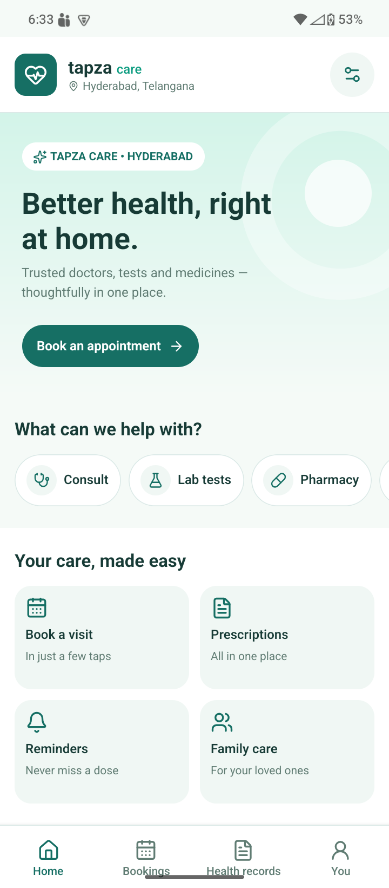<br/><b>Everyday Home</b></td>
    <td align="center">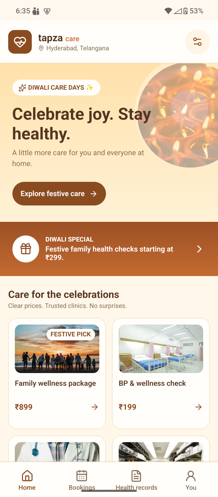<br/><b>Diwali Theme</b></td>
    <td align="center">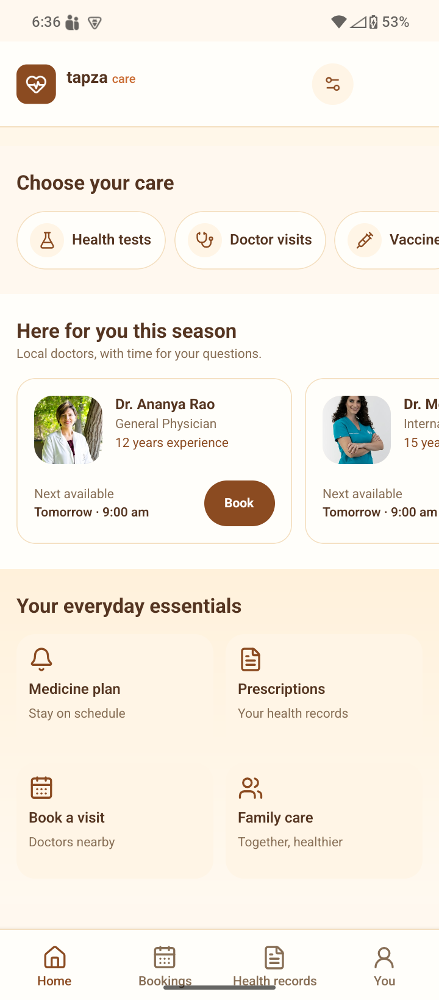<br/><b>Health Services</b></td>
  </tr>
  <tr>
    <td align="center">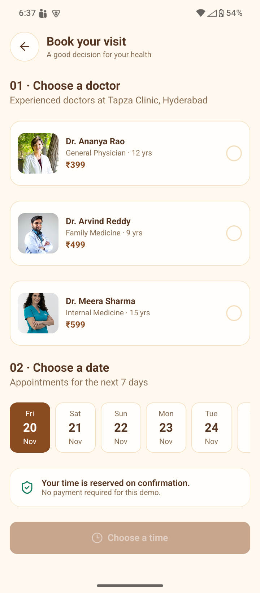<br/><b>Doctor Booking</b></td>
    <td align="center">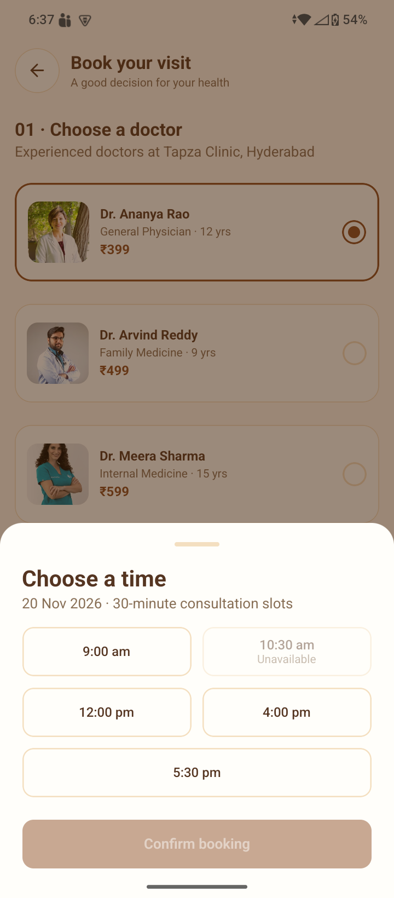<br/><b>Choose a Slot</b></td>
    <td align="center">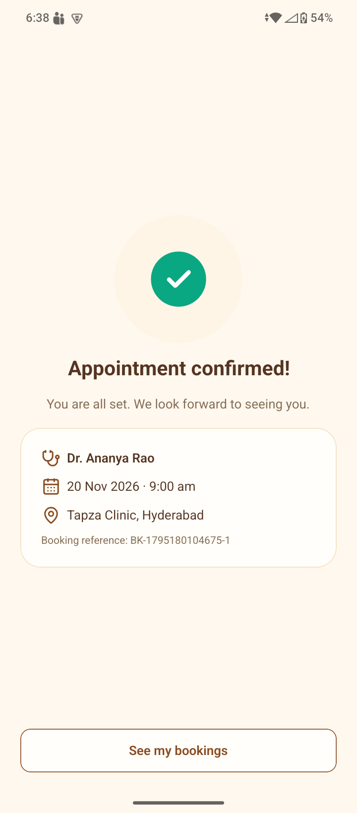<br/><b>Booking Confirmed</b></td>
  </tr>
  <tr>
    <td align="center">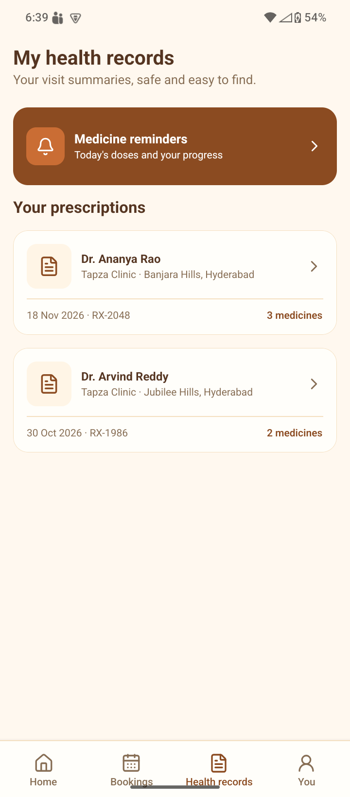<br/><b>Prescriptions</b></td>
    <td align="center">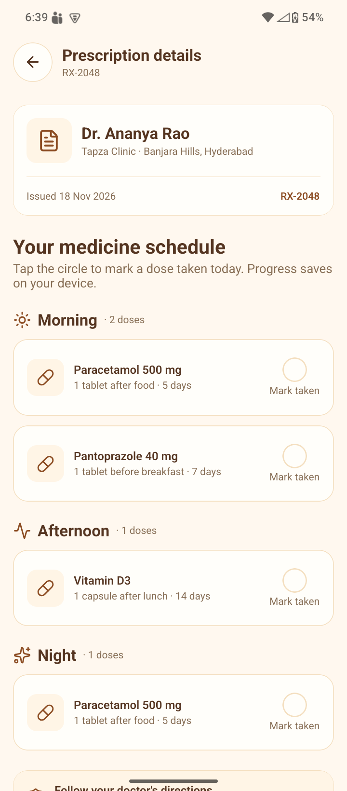<br/><b>Prescription Details</b></td>
    <td align="center">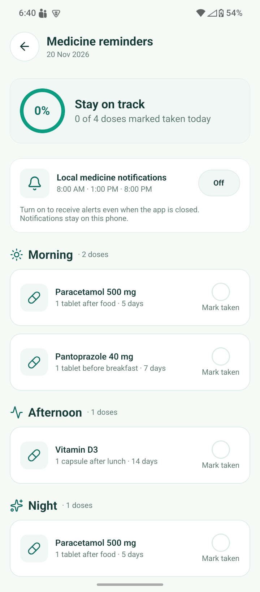<br/><b>Medicine Reminders</b></td>
  </tr>
  <tr>
    <td align="center">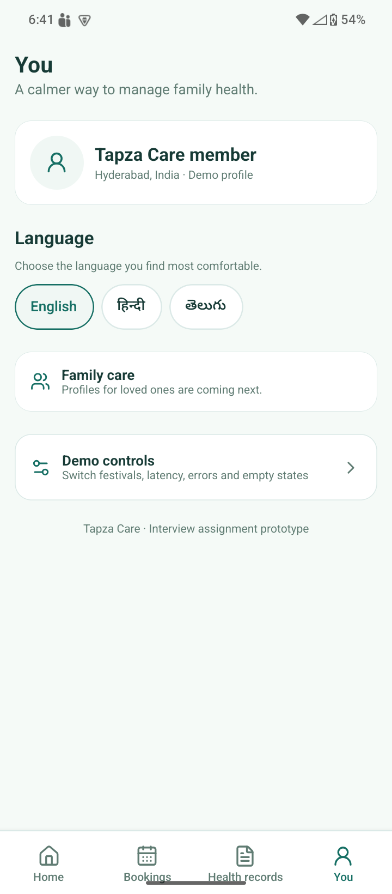<br/><b>Three Languages</b></td>
    <td align="center">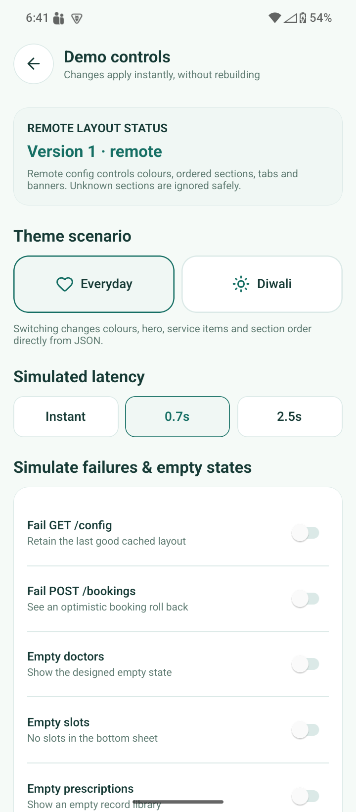<br/><b>Demo Controls</b></td>
  </tr>
</table>

---

## Features

| Area                             | Implementation                                                                                                                                                           |
| -------------------------------- | ------------------------------------------------------------------------------------------------------------------------------------------------------------------------ |
| **Dynamic home**                 | Six section types: hero banner, category chips, quick actions, service grid, doctor carousel, and offer strip. Scroll reveal, header changes, and hero parallax.         |
| **Remote-config design**         | Two mock `GET /config` scenarios — **Everyday** and **Diwali** — change colors, banner, section order, and content at runtime. Unknown section types are ignored safely. |
| **Appointments**                 | Select a doctor or service, choose a date, pick an available time in a gesture-driven bottom sheet, and confirm a booking.                                               |
| **Optimistic updates**           | Immediate booking-pending UI; the mock response reconciles success, errors, and occupied-slot conflicts.                                                                 |
| **Prescriptions**                | List prescriptions, inspect medicine details, and view morning / afternoon / night schedules.                                                                            |
| **Dose tracking**                | Mark doses as taken with an optimistic checkmark, then Saving… → green Saved on device only after durable AsyncStorage persistence; rollback on failure.                 |
| **Local medicine notifications** | Opt-in Android/iOS notifications for future doses, cancel on marking taken, background delivery, and a 15-second test button.                                            |
| **Three languages**              | English, Hindi, and Telugu; UI copy and shipped config content use language resources rather than hard-coded screen labels.                                              |
| **Smooth transitions**           | Reusable JSON-based Lottie animations for loading, success, and error states, including language/theme transition feedback.                                              |
| **Resilience**                   | Last-known-good config cache, bundled fallback config, skeletons, empty/error states, and simulated network failures.                                                    |
| **Demo controls**                | Switch theme, test 0 / 700 / 2500 ms latency, force errors, and empty API responses without a real backend.                                                              |

## 🛠 Tech Stack

| Layer               | Technology                                                            |
| ------------------- | --------------------------------------------------------------------- |
| Application         | React Native **0.88.1**, React **19.3**, TypeScript (strict)          |
| Navigation          | React Navigation, native stack and bottom tabs                        |
| State and data      | Redux Toolkit, RTK Query, typed selectors/hooks                       |
| API simulation      | In-app mock base query matching the assignment endpoints              |
| Validation          | Zod for config schema validation                                      |
| Persistence         | AsyncStorage for preferences, cached config, bookings, and dose state |
| Animations          | React Native Animated, Lottie React Native                            |
| Local notifications | `react-native-notify-kit` (on-device scheduled triggers; no FCM)      |
| Languages           | Typed `en.ts`, `hi.ts`, `te.ts` dictionaries and locale-aware content |
| Testing             | Jest, TypeScript checks, static localization and animation audits     |

## Getting Started

### Prerequisites

- Node.js **22.13+** and npm
- JDK **17**
- Android Studio, Android SDK, and an emulator or Android device with USB debugging enabled
- A configured React Native Community CLI environment (not Expo)

Follow the [official React Native environment setup guide](https://reactnative.dev/docs/set-up-your-environment) for your operating system.

### Installation

```bash
# Clone your repository (replace YOUR_USERNAME)
git clone https://github.com/YOUR_USERNAME/tapza-care.git
cd tapza-care

# Install dependencies
npm install
```

**Native folders:** The initial source handoff uses `bootstrap:native` to generate the matching React Native CLI Android/iOS template. If your local project already contains a working `android/` or `ios/` directory, keep it; do not replace it with a newly scaffolded one. Commit the native source folders after confirming your local build works, while excluding generated build outputs and signing credentials.

### Run on Android

```bash
# Terminal 1
npm start

# Terminal 2
npm run android
```

If you add or change native dependencies, perform a clean rebuild rather than reloading JavaScript only:

```bash
cd android && ./gradlew clean && cd ..
npm run android
```

### Validate the source

```bash
npm run typecheck
npm test
npm run lint
npm run audit
npm run audit:i18n
npm run audit:lottie
```

> **Build status:** A physical-device Android build and benchmark are not claimed here. Run these commands locally and record the actual results before submitting.

---

## Project Structure

```text
TapzaCare/
├── App.tsx                        # App entry and providers
├── assets/
│   └── lottie/                    # success.json, loading.json, error.json
├── docs/
│   ├── screenshots/               # Add actual PNG screenshots here
│   ├── DEMO_SCRIPT.md             # 2–3 minute demo plan
│   ├── LOTTIE.md                   # Reusable animation notes
│   └── SMOOTH_SWITCHING.md        # Theme/language performance notes
├── src/
│   ├── app/                       # Redux store, bootstrap, transition provider
│   ├── components/                # Shared UI, AppLottie, sheet, dose schedule
│   ├── config/                    # Zod config schema
│   ├── data/                      # normal.json and festival.json
│   ├── domain/                    # Typed domain models
│   ├── features/                  # Booking, reminders, settings state
│   │   └── reminders/notifications/ # Plan, scheduler, app coordinator
│   ├── localization/              # en.ts, hi.ts, te.ts and i18n helpers
│   ├── mock/                      # Mock API and network condition switches
│   ├── navigation/                # Typed navigator and routes
│   ├── screens/                   # Home, booking, prescriptions, profile, admin
│   ├── sections/                  # Config-driven section renderers / registry
│   ├── services/                  # RTK Query endpoints
│   ├── theme/                     # Semantic theme and design tokens
│   ├── utils/                     # Date utilities
│   └── __tests__/                 # Core behavior tests
├── scripts/                       # Native bootstrap and static checks
├── .github/workflows/quality.yml  # CI configuration
├── AI_LOG.md                       # AI usage and decision log
├── package.json
└── README.md
```

### Architecture at a Glance

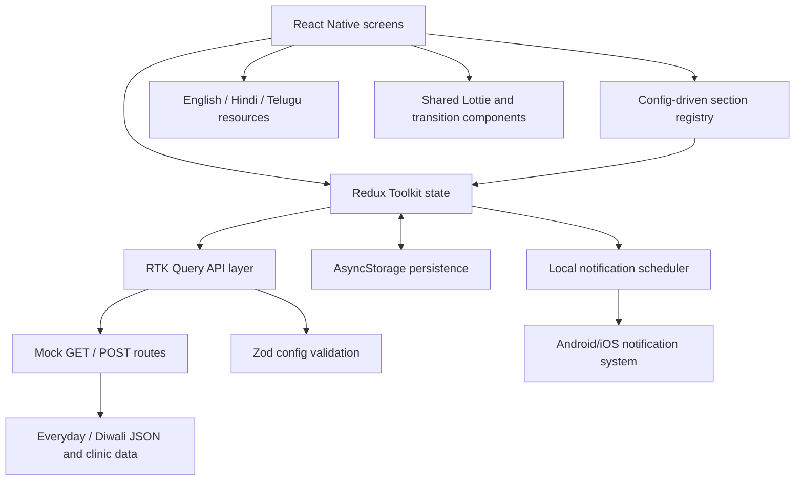

The UI does not depend on a particular backend implementation. Screen data flows through the typed API layer, validated configuration, and feature-specific state. Unknown CMS section types return `null`, so newly introduced server widgets do not crash older app versions.

## Mock API Contract

| Method | Endpoint                           | Description                                                |
| ------ | ---------------------------------- | ---------------------------------------------------------- |
| `GET`  | `/config`                          | Theme tokens, tab definitions, ordered home sections       |
| `GET`  | `/doctors`                         | Available mock doctors                                     |
| `GET`  | `/slots?doctorId=&date=YYYY-MM-DD` | Slots for a doctor and date                                |
| `POST` | `/bookings`                        | Book a slot; simulated success, failure, or `409` conflict |
| `GET`  | `/prescriptions`                   | Prescription records with medicine timings                 |
| `GET`  | `/bookings`                        | Additional endpoint for the Bookings tab                   |

The endpoints are **simulated inside the app**; no external API server or credentials are required. Mock doctor and medical content is fictional and intended for demonstration only.

### Runtime theme configuration

The config is represented by `src/data/normal.json` and `src/data/festival.json` and selected through **You → Demo controls → Theme scenario**. The home renderer supports `hero_banner`, `category_chips`, `quick_actions`, `service_grid`, `doctor_carousel`, and `offer_strip`.

**Resilience:** Config responses are validated and cached. A failed fetch uses the last good layout or the bundled fallback. Demo controls can also simulate delayed responses, empty doctors/slots/prescriptions, and failed bookings.

### Localization

Three independent resources live in `src/localization/`:

```text
en.ts   English
hi.ts   हिन्दी
te.ts   తెలుగు
```

Go to **You → Language** to change languages at runtime. The preference is persisted across restarts. Config-delivered text may also provide localized values:

```json
{
  "en": "Popular health services",
  "hi": "लोकप्रिय स्वास्थ्य सेवाएँ",
  "te": "ప్రసిద్ధ ఆరోగ్య సేవలు"
}
```

Existing legacy English-only API strings fall back to English; additional backend/CMS content should supply translations to provide complete coverage.

### Local medicine notifications and Saved state

Tapza Care supports **on-device scheduled notifications** (not Firebase/server push) using `react-native-notify-kit`. They work after the user grants permission and are scheduled for sample morning (8 AM), afternoon (1 PM), and night (8 PM) times in local time. These sample times are not medical advice. Android 12+ exact-alarm restrictions and device power management can delay delivery.

Enable notifications from **Prescriptions → Reminders**, then tap **Test notification (15 seconds)** to verify on your device. Tapping **Mark taken** shows an immediate checkmark, a Saving… indicator while writing, and **Saved on device** only after AsyncStorage confirms the write. Failed writes roll back the checkmark with a visible error.

Native package installation requires an Android rebuild (or `pod install` and rebuild for iOS). `npm run bootstrap:native` or `npm run setup:notifications` ensures Android `POST_NOTIFICATIONS` is declared. The scheduler limits pending dose notifications to 45 and refills on app foreground; longer courses may need the app reopened. See [Local Reminders setup and limitations](docs/LOCAL_REMINDERS.md).

### Reusable Lottie animations

JSON files are stored in `assets/lottie/` and selected through the typed `AppLottie` wrapper:

```tsx
<AppLottie
  fileName="success"
  size={160}
  durationMs={1800}
  autoPlay
  loop={false}
  onFinish={() => console.log('Completed')}
/>
```

The same component handles booking success, pending requests, errors, and lightweight global language/theme transition feedback. See [Lottie notes](docs/LOTTIE.md).

---

## Suggested Manual Test Scenarios

1. **Config switch:** Compare Everyday and Diwali colors, section order, imagery, and items. Check an unknown section type does not crash the screen.
2. **Booking success:** Open a doctor → select a date → choose a slot → confirm → verify booking appears in Bookings.
3. **Booking failure:** Enable `Fail POST /bookings` in Demo controls and verify the pending state resolves to a recoverable error rather than a false success.
4. **Slow network:** Set latency to **2500 ms** and verify loading skeletons and transition animations remain usable.
5. **Config failure:** Enable `Fail GET /config` and verify the last-good config remains accessible.
6. **Medicine reminder:** Turn on notifications (grant system permission), tap the 15-second test button, mark a dose taken and verify Saving… → Saved on device. Reopen the app and verify the saved checkmark. Check that its future alert is cancelled.
7. **Localization:** Switch English → Hindi → Telugu; check tabs, sections, booking, errors, prescriptions, reminders, and restart persistence.
8. **Android usability:** Test with larger system font sizes and on a mid-range device for scroll smoothness and interactive touch sizes.

## 📦 Android APK / Release

For a distributable build, configure Android release signing using the [React Native Android release guide](https://reactnative.dev/docs/signed-apk-android), then run:

```bash
cd android
./gradlew assembleRelease
```

The APK is normally generated under `android/app/build/outputs/apk/release/`. Upload the **tested, signed APK** as a GitHub Release asset. Replace the following placeholders after publishing:

- **Release page:** `https://github.com/YOUR_USERNAME/tapza-care/releases`
- **APK download:** Add the real release asset URL here.
- **Installation:** Download the APK on Android, allow installation from the chosen source when prompted, and install. Do not share signing keys.

## Assignment Coverage and Known Limits

This project prioritizes the requested home, booking, and prescription experiences. Included: six config-driven home sections, two runtime theme scenarios, booking mock states, prescription and dose tracking, loading/empty/error handling, and source tests. Bonus features implemented in the source include three-language resources, reusable Lottie, in-app mock admin controls, and local scheduled medicine alerts.

**Not included or not verified:** real healthcare backend, account authentication, WhatsApp delivery, payments, offline booking synchronization, live clinic inventory, signed APK, real-device screenshots/video, or verified performance measurements. The Family area is a placeholder. Notification delivery has not yet been verified on a physical device in this handoff. These should not be described as production-ready features.

---

<div align="center">

**Tapza Care** · Built for the Tapza Technologies Mobile Engineer assignment

_Healthcare software demo — not intended for medical advice or real patient data._

</div>
